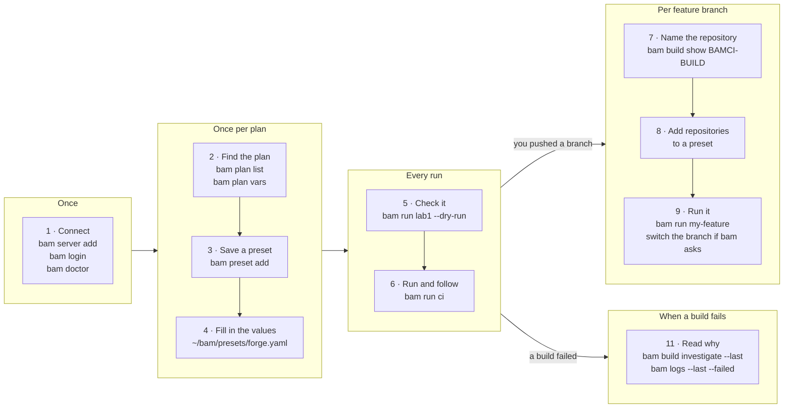

# bam

A terminal remote control for Atlassian Bamboo: run a plan, follow the build, read why it failed and open it in Bamboo, without the browser.

    bam run BAMCI-BUILD --watch
    bam logs --last --failed
    bam open --last

bam works with Bamboo Data Center 9.x and later, using a personal access token. Every example below is a real run against a small Bamboo, with only the address changed to `bamboo.example.com`.

## Install on Ubuntu and WSL

WSL runs Linux, so install the Linux build there, not the Windows one. Pick the newest version on the [releases page](https://github.com/rojcarranza/bam/releases) and put it in `v`:

    v=0.3.0
    mkdir -p ~/.local/bin
    curl -fsSL "https://github.com/rojcarranza/bam/releases/download/v${v}/bam_${v}_linux_amd64.tar.gz" | tar -xz -C ~/.local/bin bam
    bam version

If `bam` is not found, add `export PATH="$HOME/.local/bin:$PATH"` to `~/.bashrc` and open a new terminal. With Go 1.26 or newer, `go install github.com/r0jjames/bam-cli/cmd/bam@latest` works too (it installs into `~/go/bin`).

On WSL, `bam open` needs a way to reach the Windows browser:

    sudo apt install wslu
    echo 'export BROWSER=wslview' >> ~/.bashrc

Without it, `bam open` prints the link and you click it. macOS and Windows: download the archive for your system from the same page and put `bam` on your PATH.

## Connect to your Bamboo

Three steps, once. You need a personal access token: in Bamboo, open your profile, then Personal access tokens, then Create token.

    $ bam server add work --url https://bamboo.example.com --project BAMCI --project FORGE
    added server work (https://bamboo.example.com) to ~/.config/bam/config.yaml
    next: bam login work

    $ bam login work                 # paste the token when asked
    logged in to work as jdoe (J Doe); token stored in ~/.config/bam/credentials.yaml (no keychain available)

`--project` limits the plan lists and the terminal UI to the Bamboo projects you work in. On WSL there is usually no keyring, so bam keeps the token in `~/.config/bam/credentials.yaml`, readable only by you. Then check the connection:

    $ bam doctor
    ✓ config             ~/.config/bam/config.yaml
    ✓ server             work (https://bamboo.example.com)
    ✓ token              file
    ✓ auth               admin (Admin)
    ✓ server version     12.1.8
    ✓ plan variables     0 declared on BAMCI-BUILD
    ✓ build variables    read from BAMCI-BUILD-7
    ✓ logs               via entries
    ✓ duration estimate  read from BAMCI-BUILD-7
    – failed tests       no failed build of BAMCI-BUILD to read
    ✓ stop builds        confirmed by an earlier cancel
    – rerun builds       learned the first time bam set rerun --failed runs

A check marked `–` is not a problem: bam learns it the first time you use that feature. A teammate who clones your repository only needs `bam login work`. More: [Authentication](docs/authentication.md), [Configuration](docs/configuration.md), [Troubleshooting](docs/troubleshooting.md).

## The example pipeline

Every example uses the same small pipeline, so each command follows from the one before:

| Plan | What it does |
| --- | --- |
| `BAMCI-BUILD` | runs `make build`, then triggers the two plans below |
| `BAMCI-TEST` | runs `make test` (a child of `BAMCI-BUILD`) |
| `BAMCI-LINT` | runs `make lint` (a child of `BAMCI-BUILD`) |
| `FORGE-PROV` | provisions a cluster; takes the variables `cluster_name` and `cluster_config` |

`BAMCI-*` has no variables. `FORGE-PROV` has some, so it carries the examples about variables, and those stay dry runs.

## Commands

The sections below follow the order you use bam in. You connect once, save a preset for each plan, then check and run it by name:

Where a command takes a build, `--last` means the build you started last from this directory. Every read command takes `--json`. `bam <command> --help` shows all flags; the full reference is in [docs/cli](docs/cli/bam.md).

### Find your plan

`bam project list`, `bam plan list`, `bam plan show`, `bam plan vars` and `bam plan branches` list what exists. In Bamboo this is the Projects menu and a plan's page. Note the plan key and its variables; the next step saves them as a preset.

    $ bam plan list BAMCI
    BAMCI  bam CI
      PLAN         NAME   LAST  STATE      COMPLETED             REASON
      BAMCI-BUILD  Build  #7    ✓ success  2026-11-02T16:57:35Z  Manual run by Admin
      BAMCI-LINT   Lint   #7    ✓ success  2026-11-02T16:57:37Z  Child of BAMCI-BUILD-7
      BAMCI-TEST   Test   #7    ✓ success  2026-11-02T16:57:38Z  Child of BAMCI-BUILD-7

    $ bam plan vars FORGE-PROV
    NAME            VALUE  LAST USED (#13)
    cluster_config  –      –
    cluster_name    lab1   setcheck

| You want to | Type |
| --- | --- |
| list your Bamboo projects | `bam project list` |
| see a plan with its branches and recent builds | `bam plan show BAMCI-BUILD` |
| list a plan's branches | `bam plan branches BAMCI-TEST` |
| find a plan by part of its name | `bam plan list --match test` |
| see which repository a plan builds | `bam build show BAMCI-BUILD`, under Revisions |

### Save it as a preset

A preset is a plan plus the variable values you run it with, under a name you choose. Save one before your first run. `bam preset add` reads the plan's variables from Bamboo and writes the preset for you, in `~/bam/presets/`, one file per Bamboo project:

    $ bam preset add lab1 --plan FORGE-PROV
    added preset lab1 to ~/bam/presets/forge.yaml
    review before commit: values copied from Bamboo

    $ bam preset add ci --plan BAMCI-BUILD
    added preset ci to ~/bam/presets/bamci.yaml

bam writes `plan:`, the server you added it on, every variable the plan declares with its plan default filled in, and `watch: true`, with no per-line comments. When a variable ran with different values in the plan's last 10 builds, `preset add` also prints a box in the terminal listing up to three of them, newest first, so you can pick one. Open the file, set the values, and add the keys you want, such as `options` and `required`. Filled in, the two files look like this; only `plan` is required.

`~/bam/presets/forge.yaml`:

    # ~/bam/presets/forge.yaml: presets for FORGE-* plans
    presets:
      lab1:                          # the name you type: bam run lab1
        plan: FORGE-PROV             # Bamboo plan key (required)
        # branch: develop            # optional: an existing plan branch to run
        # server: work               # optional: a server alias, when you have several
        variables:                   # sent with every run; leave one out to keep the plan's value
          cluster_name: lab1
          cluster_config: lab1
        options:                     # allowed values; anything else is refused before the run
          cluster_config: [lab1, dcos1, reference]
        required: [cluster_config]   # must have a value before the run
        watch: true                  # follow the build, as --watch does
        timeout: 45m                 # stop waiting after 45 minutes

`~/bam/presets/bamci.yaml`, with a second preset that builds a feature branch (see [Test a feature branch](#test-a-feature-branch)):

    # ~/bam/presets/bamci.yaml: presets for BAMCI-* plans
    presets:
      ci:                       # the name you type: bam run ci
        plan: BAMCI-BUILD       # Bamboo plan key (required)
        watch: true             # follow the build, as --watch does

      my-feature:                                # bam run my-feature
        plan: BAMCI-BUILD                        # the parent plan
        branch: develop                          # an existing plan branch; repositories: needs it
        repositories:                            # the branch each repository of that plan branch must build
          bam: fix/ignore-undotted-bam-yaml
        watch: true

Check it with a dry run, which resolves and checks every value and starts nothing. A value outside `options` is refused before anything runs:

    $ bam run lab1 --dry-run
    Plan     FORGE-PROV
    Vars     cluster_config=lab1 (preset)  cluster_name=lab1 (preset)
    dry run: nothing triggered

    $ bam run lab1 --var cluster_config=splunk9 --dry-run
    error: cluster_config="splunk9" is not allowed by preset lab1
      allowed: lab1, dcos1, reference

`bam run lab1` then works from any directory. bam reads four files, and the presets file is the one you edit:

| File | What it holds | Written by |
| --- | --- | --- |
| `~/.config/bam/config.yaml` | servers, their projects, preferences | `bam server add` |
| `~/.config/bam/credentials.yaml` | your token, when there is no keychain | `bam login` |
| `~/bam/presets/<project>.yaml` | your presets, under `presets:` with `variables:` | `bam preset add` |
| `.bam.yaml` at the repository root | team presets, under `targets:` with `defaults:`; committed | `bam preset add --shared`, `bam init` |

More: [Presets](docs/presets.md), [Configuration](docs/configuration.md); `bam init` writes a team's `.bam.yaml` with presets generated from plans.

| You want to | Type |
| --- | --- |
| list your presets and their files | `bam preset list` |
| see one preset | `bam preset show lab1` |
| add variables the plan gained since | `bam preset sync lab1 --dry-run` |
| remove a preset | `bam preset rm lab1` |
| generate a repository's `.bam.yaml` | `bam init --server work --project BAMCI --plan BAMCI-BUILD=ci` |

### Run it

`bam run` starts a preset, or a plan by its key, and prints the link to the build. In Bamboo this is the plan's Run, then Run customised, page. `ci` sets `watch: true`, so bam follows the build and every build it triggers:

    $ bam run ci
    Plan     BAMCI-BUILD
    Vars     none
    ✓ Queued   BAMCI-BUILD-8   https://bamboo.example.com/browse/BAMCI-BUILD-8
    BAMCI-BUILD-8 (Build)   ✓ success  3s
    ├─ stage Build          ✓ success  3s
    ├─ BAMCI-LINT-8 (Lint)  ✓ success  3s
    │  └─ stage Lint        ✓ success  3s
    └─ BAMCI-TEST-8 (Test)  ✓ success  14s
       └─ stage Test        ✓ success  10s

On a terminal the tree redraws while the builds run. bam exits 0 when every build succeeded and 1 when one did not. Ctrl-C stops watching; the builds keep running.

| You want to | Type |
| --- | --- |
| run a plan by its key and follow it | `bam run BAMCI-BUILD --watch` |
| set a variable | `bam run FORGE-PROV --var cluster_name=lab2` |
| see what would be sent, start nothing | `bam run FORGE-PROV --var cluster_name=lab2 --dry-run` |
| reuse the last build's variables | `bam run FORGE-PROV --from last` |
| change them in your editor first | `bam run FORGE-PROV --from last --edit` |
| run an existing plan branch | `bam run BAMCI-BUILD --branch fix-cancel-stale-tree-reads` |
| build one commit | `bam run BAMCI-BUILD --revision 41d06ce` |
| test a pushed branch on a plan branch | `bam run BAMCI-BUILD --branch develop --repository bam=fix/cancel-stale-tree-reads --dry-run` (see Test a feature branch) |
| run a saved preset | `bam run lab1` (see Save it as a preset) |

### Test a feature branch

You pushed a branch and want a plan branch to build it. Bamboo does not let bam change which branch a plan branch's repository builds, so you switch it in your browser and bam checks it before it triggers. bam never saves that page and never puts the old branch back.

1. Find the repository's name, under Revisions:

       $ bam build show BAMCI-BUILD
       ...
       Revisions   bam 7ec79b3

2. Add a preset on the plan branch, then give it the branch. `bam preset add my-feature --plan BAMCI-BUILD --branch develop` writes the plan, the branch and every repository of `develop` with the branch it built last; edit the one you want in `~/bam/presets/bamci.yaml`:

       my-feature:
         plan: BAMCI-BUILD
         branch: "develop"
         repositories:
           bam: "fix/ignore-undotted-bam-yaml"
         watch: true

   `repositories:` needs `branch:` in the same preset. It covers that plan branch only, not the child plans it triggers.

3. Run it. bam reads the branch `bam` built in the newest finished job of `develop`. When it already builds the wanted branch, bam triggers with no question. When it differs, or no job has finished, bam prints the Repositories tab link, opens it and waits:

       $ bam run my-feature
       Plan     BAMCI-BUILD  (branch develop, BAMCI-BUILD7)
       Repos    BAMCI-BUILD7 built these branches in BAMCI-BUILD7-4; this run wants:
         bam  main → fix/ignore-undotted-bam-yaml
         Repositories tab: https://bamboo.example.com/branch/admin/config/configureChainBranchRepositories.action?planKey=BAMCI-BUILD7
       Switch the branches on the Repositories tab, save, then press Enter to trigger (Ctrl-C stops):
       ✓ Queued   BAMCI-BUILD7-5   https://bamboo.example.com/browse/BAMCI-BUILD7-5
       ...
       bam built fix/ignore-undotted-bam-yaml

   With `--json` or no terminal, bam stops before triggering and prints the link. `--dry-run` opens and triggers nothing. When the followed build is over, bam compares again and warns if it used another branch; it never stops the build.

The branch stays as you left it, so the next run of a preset that names another branch asks you to switch back.

| You want to | Type |
| --- | --- |
| try another branch once | `bam run my-feature --repository bam=fix/other-branch --dry-run` |
| do it without a preset | `bam run BAMCI-BUILD --branch develop --repository bam=fix/ignore-undotted-bam-yaml` |
| skip the check after the build | `bam run my-feature --watch=false` |

In the terminal UI, `R` on the preset shows the repositories as read-only rows in the run form and asks in a dialog when a branch differs.

More: [Build other repository branches](docs/presets.md#build-other-repository-branches).

### Keep your presets in your dotfiles

Presets are plain files, so they live well in a dotfiles repository. A layout that works:

    dotfiles/
    └── bam/
        ├── presets.yaml            # presets without a project file
        └── presets/
            ├── bamci.yaml          # BAMCI-* plans: ci, my-feature
            └── forge.yaml          # FORGE-* plans: lab1

One file per Bamboo project, named after the project key, each starting with `presets:`. Point bam at the folder on every machine, and give the server the same alias everywhere so a preset's `server:` resolves:

    export BAM_PRESETS="$HOME/dotfiles/bam/presets.yaml"   # also reads dotfiles/bam/presets/

Keep out of the dotfiles: tokens (`bam login` stores them in the keychain or `~/.config/bam/credentials.yaml`) and secret values (use `${ENV}` references). Team presets stay in each repository's `.bam.yaml`, not in your dotfiles. Machine paths for WSL and Git Bash: [Presets](docs/presets.md#one-presets-directory-for-git-bash-wsl-and-macos).

### Follow a build

`bam watch` follows a build and every build it triggers until they finish. In Bamboo this is the build page, open and refreshing.

    $ bam watch --last
    BAMCI-BUILD-7 (Build)   ✓ success  1s
    ├─ stage Build          ✓ success  1s
    ├─ BAMCI-LINT-7 (Lint)  ✓ success  1s
    │  └─ stage Lint        ✓ success  1s
    └─ BAMCI-TEST-7 (Test)  ✓ success  3s
       └─ stage Test        ✓ success  1s

Watching never stops a build, so Ctrl-C is safe. A finished build exits 0 on success and 1 on failure, which makes `bam run PLAN --watch && deploy` work in a script.

| You want to | Type |
| --- | --- |
| watch a build by its key | `bam watch BAMCI-BUILD-7` |
| watch the newest build of a plan | `bam watch BAMCI-BUILD` |
| draw the tree of a build and its children | `bam build tree BAMCI-BUILD-7` |
| follow that tree until every build finishes | `bam build tree BAMCI-BUILD-7 --watch` |
| stop waiting after 30 minutes | `bam watch --last --timeout 30m` |

### When a build fails

Start from the failed build. `bam build investigate` picks out the error and the likely cause, and `bam logs --failed` prints only the failed jobs' logs. In Bamboo this is the build's Logs and Tests tabs. This build is `BAMCI-TEST` on a short-lived branch with a test that fails on purpose:

    $ bam build investigate BAMCI-TEST6-2
    BAMCI-TEST6-2  ✗ failed
    Reason: Manual run by Admin

    Test / Test (TEST)  first error at line 10
            7  ok  	github.com/r0jjames/bam-cli/internal/cli	(cached)
            8  ok  	github.com/r0jjames/bam-cli/internal/config	(cached)
            9  ok  	github.com/r0jjames/bam-cli/internal/credential	(cached)
      >    10  --- FAIL: TestDemoFailure (0.00s)
           11      demo_failing_test.go:6: deliberate failure for the README example
           12  FAIL
           13  FAIL	github.com/r0jjames/bam-cli/internal/errs	0.012s

    Failed tests: none reported
    Likely cause: --- FAIL: TestDemoFailure (0.00s) (job TEST)
    try: bam logs BAMCI-TEST6-2 --job TEST

| You want to | Type |
| --- | --- |
| run a plan branch and follow it | `bam run BAMCI-TEST --branch demo-readme-failing-test --watch` |
| read only the failed jobs' logs | `bam logs BAMCI-TEST6-2 --failed` |
| read the last 50 lines of the newest failure | `bam logs --last --failed -n 50` |
| read one job's whole log | `bam logs BAMCI-TEST6-2 --job TEST` |
| compare with the last green build | `bam build investigate BAMCI-TEST6-2 --compare` |
| show only the failing branches of a tree | `bam build tree BAMCI-BUILD-7 --failed` |

### Retry or stop

`bam build rerun` restarts a failed build's failed jobs, as Bamboo's Rerun failed jobs does: same build key, same variables, same commit. `bam build cancel` stops a queued or running build. Check a rerun first with `--dry-run`:

    $ bam build rerun BAMCI-TEST6-2 --dry-run
    would rerun BAMCI-TEST6-2 (failed)
    dry run: nothing restarted

    $ bam run BAMCI-BUILD
    Plan     BAMCI-BUILD
    Vars     none
    ✓ Queued   BAMCI-BUILD-3   https://bamboo.example.com/browse/BAMCI-BUILD-3
      watch: bam watch BAMCI-BUILD-3

    $ bam build cancel --last
    stopping BAMCI-BUILD-3
      watch: bam watch BAMCI-BUILD-3

| You want to | Type |
| --- | --- |
| rerun the failed jobs and watch them | `bam build rerun BAMCI-TEST6-2 --watch` |
| rerun every failed build of a tree | `bam build tree BAMCI-BUILD-7 --rerun-failed` |
| cancel a build by key | `bam build cancel BAMCI-BUILD-3` |
| check a cancel first | `bam build cancel --last --dry-run` |

### Open it in Bamboo

`bam open` opens a project, plan, build or job in your browser. `bam url` prints the same link without opening it, to paste into chat.

    $ bam url BAMCI-TEST6-2
    https://bamboo.example.com/browse/BAMCI-TEST6-2

    $ bam open BAMCI-TEST6-2 --job TEST
    https://bamboo.example.com/browse/BAMCI-TEST6-TEST-2
    warning: could not open a browser: exec: "xdg-open,x-www-browser,www-browser": executable file not found in $PATH

| You want to | Type |
| --- | --- |
| open the build you just started | `bam open --last` |
| open a plan | `bam open BAMCI-BUILD` |
| open one job of a build | `bam open BAMCI-TEST6-2 --job TEST` |
| print the link of a plan's job | `bam url BAMCI-TEST --job TEST` |

On WSL this opens your Windows browser once `wslu` is installed (see Install). If no browser opens, bam prints the link and a warning, as above, and the link still works.

### Look at past builds

`bam build list`, `bam build show` and `bam plan stats` read history. In Bamboo this is the plan's build list and a build's Summary tab.

    $ bam build show BAMCI-BUILD-7
    BAMCI-BUILD-7  ✓ success  https://bamboo.example.com/browse/BAMCI-BUILD-7
    Plan        BAMCI-BUILD
    Reason      Manual run by Admin
    Started     2026-11-02T16:57:33Z
    Completed   2026-11-02T16:57:35Z
    Duration    1s
    Revisions   bam 7ec79b3

    $ bam plan stats BAMCI-BUILD
    BAMCI-BUILD  last 7 builds (#1–#7, 4h25m)
    Success   100%  (7 ✓  0 ✗)   streak ✓ 7
    Duration  median 3s  p90 5s  max 5s (#1)   of 7 successful
    Failing jobs none

| You want to | Type |
| --- | --- |
| list recent builds of a plan | `bam build list BAMCI-BUILD` |
| list the builds of one plan branch | `bam build list BAMCI-TEST --branch fix-tree-running-time` |
| see the build you just started | `bam build show --last` |
| see how often a plan fails | `bam plan stats BAMCI-TEST` |

### Run plans in order

A set runs several presets in stages: every run of a stage at once, the next stage only when all of them succeeded. In Bamboo there is no single page for this. You write the sets under `sets:` in `.bam.yaml`: `check: [[ci]]` and `ship: [[ci], [lab1]]`.

    $ bam set run ship --dry-run
    ship
    stage 1/2
      ci  BAMCI-BUILD  branch default
    stage 2/2
      lab1  FORGE-PROV  branch default
    dry run: nothing triggered

    $ bam set run check
    check  check-20261102T165338Z
    stage 1/1
      ✓ ci  BAMCI-BUILD-6  Success  1s

    set succeeded

A failure never cancels a build, and Ctrl-C stops watching only. Matrix runs, train files (`bam set run -f`) and the rules: [docs/configuration.md](docs/configuration.md#sets-release-trains). `bam set list` lists your sets.

| You want to | Type |
| --- | --- |
| see a set's stages | `bam set show ship` |
| see the newest run's builds | `bam set status` |
| list past runs | `bam set history check` |
| continue after Ctrl-C | `bam set resume` |
| retry the failed runs, then finish | `bam set rerun --failed` |

### Setup and housekeeping

- `bam server list` shows the servers you added; `bam server default work` picks the one used when none is named; `bam server rm work` removes one.
- `bam whoami` shows who each server knows you as; `bam logout work` deletes the stored token.
- `bam version` prints the installed version.
- `bam completion bash` prints tab completion for bash (`bam completion zsh`, `fish` and `powershell` too); to load it in every new session, add `source <(bam completion bash)` to `~/.bashrc`.
- `bam preset migrate` moves presets from the old machine config into your presets files.
- Every command has `--help`, and `--debug` logs the HTTP requests bam makes.

## Terminal UI

Typing `bam` alone opens a full-screen view of your plans. You can browse, watch, read logs, run and cancel from it, with the keys shown at the bottom. `bam --project BAMCI` opens it on one project, and `bam ui` opens it explicitly. Pipe bam's output, or pass `--no-tui`, and bare `bam` prints help instead.

### The plans table

    bam v0.2.1-544-g7ec79b3 · home · 12.1.8 · admin · project BAMCI · 3 plans · sort key↑
      PROJECT  KEY          NAME                                          STATE             #  AGE    BY
    ▸ BAMCI    BAMCI-BUILD  Build                                         ✓ success         6  now    Admin
      BAMCI    BAMCI-LINT   Lint                                          ✓ success         6  now    dep
      BAMCI    BAMCI-TEST   Test                                          ✓ success         6  now    dep

    home · 12.1.8 · admin                                enter open  / filter  s sort  : cmd  R run  ?help  q quit

`enter` opens a plan, `/` filters, `s` sorts, `:` opens the command bar, `?` shows every key.

### The plan screen

     Build
     BAMCI › BAMCI-BUILD                                                           ✓ success last build #7 1m ago
    ───────────────────────────────────────────────── builds[7] ──────────────────────────────────────────────────
    ┏━Builds━━━━━━━━━━━━━━━━━━━━━━━━━━━━━━━━━━━┓╭─Stages · #7────────────────────────────────────────────────────╮
    ┃▸ ✓ #7     default  1m  Admin             ┃│Manual run by Admin · 7ec79b3                                   │
    ┃  ✓ #6     default  5m  Admin             ┃│                                                                │
    ┃  ✓ #5     default  6m  Admin             ┃│▸ ✓ Build                      1s                               │
    ┃  ✓ #4     default  6m  Admin             ┃╰────────────────────────────────────────────────────────────────╯
    ┃  ✓ #3     default  6m  Admin             ┃╭─Tree · what #7 triggered───────────────────────────────────────╮
    ┃  ✓ #2     default  4h  Admin             ┃│▸ ✓ Lint  #7    success                                         │
    ┃  ✓ #1     default  4h  Admin             ┃│  ✓ Test  #7    success                                         │
    ┃                                          ┃│                                                                │
    ┃                                          ┃│                                                                │
    ┃                                          ┃│                                                                │
    ┃                                          ┃│                                                                │
    ┃                                          ┃│                                                                │
    ┃                                          ┃│                                                                │
    ┃                                          ┃│                                                                │
    ┃                                          ┃│                                                                │
    ┃                                          ┃│                                                                │
    ┃                                          ┃│                                                                │
    ┃                                          ┃│                                                                │
    ┃                                          ┃│                                                                │
    ┗━━━━━━━━━━━━━━━━━━━━━━━━━━━━━━━━━━━━━━━━━━┛╰────────────────────────────────────────────────────────────────╯
    work · 12.1.8 · admin                                  enter stages  R run  l logs  t tree  / filter  esc back

`enter` on a plan opens its screen: builds on the left, the stages of the selected build and the plans it triggered on the right. `esc` goes back.

### Do it in the UI

| You want to | Press |
| --- | --- |
| run the selected plan | `R`, set variables, then `ctrl-R` (`d` previews the dry run) |
| build a feature branch on a plan branch | `R` on a preset with `repositories:`; the form shows them read-only and asks in a dialog when a branch differs |
| read the failed log of a build | `l` |
| see what a build triggered | `t` |
| rerun the failed builds of a tree | `F` (asks first) |
| cancel the selected build | `C` (asks first) |
| open the selection in your browser | `o` |
| copy the selection's link | `y` |
| save the selected build's variables as a preset | `p` |
| go back, or quit | `esc`, `q` |

Nothing changes on the server by accident. No lowercase key starts or stops a build: `R` only opens the run form, `ctrl-R` is the only key that starts one, and `C` always asks. Leaving the UI never stops a build. `y` copies through the terminal (OSC 52), which Windows Terminal supports. The full key list, run sets and build trees in the UI: [docs/tui.md](docs/tui.md).

## More

- [Configuration and presets](docs/configuration.md)
- [Presets and re-running with other variables](docs/presets.md)
- [Terminal UI keys](docs/tui.md)
- [Authentication](docs/authentication.md)
- [Using bam in CI](docs/ci.md)
- [JSON output](docs/json.md)
- [Troubleshooting](docs/troubleshooting.md)
- [Try bam locally, without a Bamboo](docs/try-locally.md)
- [Development setup](SETUP.md): Go, make and linter on macOS and Linux

## License

MIT
